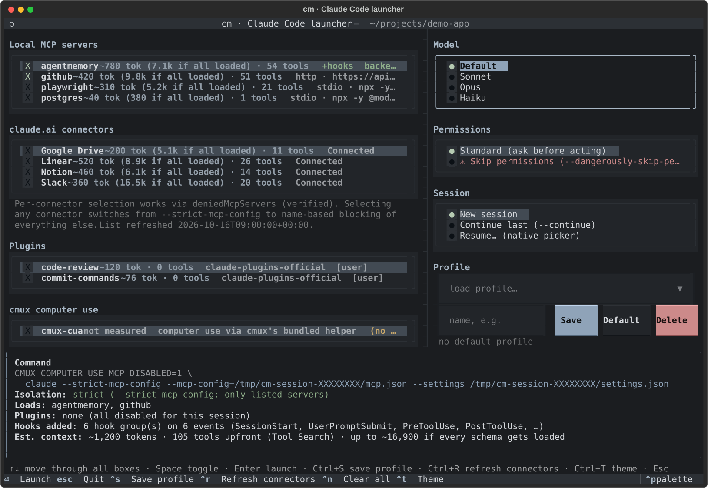
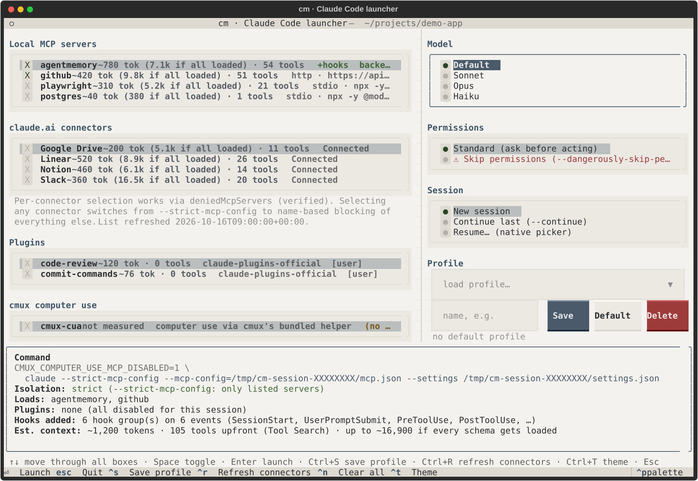

<div align="center">

# cm

**Launch Claude Code with exactly the MCP servers you pick. No more, no less.**

[](LICENSE)
[](pyproject.toml)
[](#install)
[](#how-it-works)



</div>

Every MCP server, claude.ai connector and plugin you have configured loads into **every** Claude Code session. Most of them sit there unused, taking up context and adding tools the model has to choose from. `cm` lets you pick what a session gets, then starts `claude` with exactly that and nothing else.

```bash
cm                                   # pick on a keyboard-driven screen, press Enter
cm --mcp agentmemory,github          # or headless: just these two servers
```

## Features

- **Exact selection.** Choose local MCP servers, claude.ai connectors (one by one), plugins and cmux computer use per session. Anything you don't pick doesn't load, and that was verified with real launches.
- **See the cost first.** Each item shows its measured context cost, and the preview adds up the total before you launch.
- **Profiles.** Save combinations like `memory+github` or `research`, set a default and override it with flags.
- **Remembers each project.** The screen opens with what you last launched in that project (never Skip permissions), so you don't tick the same servers every time.
- **Recent sessions, forks and names.** Resume one of the project's last sessions from the screen, optionally as a named fork, and give every session a name at launch (`--name`), so `/rename` isn't needed afterwards.
- **Worktrees.** Start a session, or a fork of a recent one, in its own git worktree (`claude -w`), named after the session. cm warns before Claude would reuse, reset or replace an existing worktree, and lists the sessions of the repository's worktrees too.
- **Hooks follow their server.** A server's hooks (for example AgentMemory's) run only in sessions where that server is selected.
- **Keyboard-first screen.** ↑/↓ flow through every box, Space toggles, Enter launches. Seven sober themes, with WCAG-contrast text.
- **Scriptable.** Every choice is also a flag, and anything after `--` goes to `claude` unchanged.
- **Safe by design.** No shell, private (0600) session files, secrets redacted in every preview. It never edits your Claude Code configuration, and your `~/.claude/settings.json` (env, permissions, model…) still applies as usual.
- **Optional AgentMemory setup.** One command installs [AgentMemory](https://github.com/rohitg00/agentmemory) and wires its MCP server and hooks into cm.

## Contents

- [Install](#install) · [Reinstall / new machine](#reinstall--new-machine) · [Usage](#usage) · [The screen](#the-screen) · [Last selection per project](#last-selection-per-project) · [Themes](#themes)
- [Configuration](#configuration) · [Profiles](#profiles) · [Sessions: recent, fork, name](#sessions-recent-fork-name) · [Worktrees](#worktrees--w) · [claude.ai connectors](#claudeai-connectors) · [Plugins](#plugins) · [cmux computer use](#cmux-computer-use-optional)
- [AgentMemory](#agentmemory-optional)
- [How it works](#how-it-works) · [Verify on your machine](#verify-on-your-machine)
- [Security](#security) · [Troubleshooting](#troubleshooting) · [Limitations](#limitations) · [Development](#development)

## Install

You need [Claude Code](https://docs.claude.com/en/docs/claude-code/setup) (`claude` on your PATH). The installer handles everything else. **macOS and Linux** only.

```bash
curl -fsSL https://raw.githubusercontent.com/vams-mx/claude-launcher/main/install.sh | sh
```

or from a checkout:

```bash
git clone https://github.com/vams-mx/claude-launcher && cd claude-launcher
sh install.sh
```

Then:

```bash
cm --refresh      # cache your claude.ai connector list (runs `claude mcp list`)
cm --where        # see where cm looks for MCP servers
cm                # pick and launch
cm --measure      # optional: measure each item's real context cost (cheap Haiku probes, a few cents)
```

<details>
<summary><b>What the installer does, options, manual install, uninstall</b></summary>

The installer:

1. checks the OS and stops on anything other than macOS or Linux;
2. installs [uv](https://docs.astral.sh/uv/) with its official installer if it's missing (uv provides a Python ≥ 3.11 for cm if needed);
3. runs `uv tool install git+https://github.com/vams-mx/claude-launcher` (or the checkout), which puts `cm` in uv's tool bin directory, usually `~/.local/bin`;
4. creates `~/.claude-launcher/` with a commented `config.json` and an empty `mcps/` folder (`cm setup init`);
5. checks that `claude` is on your PATH and tells you how to install it if not;
6. offers the optional [AgentMemory](#agentmemory-optional) setup, asking once.

Re-running it is safe: it upgrades cm and never touches your data in `~/.claude-launcher/` (config, profiles, MCP files, caches, session files). Options, all environment variables: `CM_REPO=<user>/claude-launcher` and `CM_REF=<branch|tag>` (install a fork or a version), `CM_SOURCE=<path|url>` (install exactly this), `CM_EDITABLE=1` (editable install from a checkout), `INSTALL_AGENT_MEMORY=0|1`, `CM_CONFIG_DIR=<dir>`.

Manual install, if you prefer: `uv tool install git+https://github.com/vams-mx/claude-launcher` (or `pipx install …`), then `cm setup init`.

To uninstall: `uv tool uninstall claude-launcher`, then delete `~/.claude-launcher/` if you don't want your profiles any more (and see [removing AgentMemory](#removing-agentmemory)).

</details>

## Reinstall / new machine

**Upgrade or reinstall** with either of these. Both replace only cm's program (uv's tool environment); everything in `~/.claude-launcher/` stays exactly as it is:

```bash
curl -fsSL https://raw.githubusercontent.com/vams-mx/claude-launcher/main/install.sh | sh
uv tool install --force --reinstall-package claude-launcher git+https://github.com/vams-mx/claude-launcher
```

**A second machine:**

```bash
curl -fsSL https://raw.githubusercontent.com/vams-mx/claude-launcher/main/install.sh | sh   # 1. install
cm setup init                                   # 2. ~/.claude-launcher with an example config (the installer already ran it)
scp old:.claude-launcher/config.json ~/.claude-launcher/          # 3. copy your config…
scp -r old:.claude-launcher/profiles ~/.claude-launcher/          #    …and your profiles
cm --refresh                                    # 4. this machine's claude.ai connectors
cm setup agentmemory                            # 5. optional: AgentMemory, with this machine's paths
cm --where                                      # 6. check: config home, MCP folders (missing ones say so), servers
```

Copy **only `config.json` and `profiles/`**. Everything else in `~/.claude-launcher/` is per machine:

* `sessions/` holds the files cm passes to Claude. They contain absolute paths of this machine (hook scripts, the cmux client, cmux's socket and state directories), so they are never reused on another machine. Their names are content hashes, so another machine's files could never be mistaken for this one's, but don't copy or sync the directory.
* **A synced config home** (`CM_CONFIG_DIR` in iCloud Drive, Dropbox, Google Drive, OneDrive): `sessions/` would sync too, and one machine's cleanup could delete another machine's session files. Keep them local with `export CM_SESSIONS_DIR=~/.local/state/cm-sessions` (any local directory). `cm --where` shows where session files go and warns when that is inside a synced folder.
* `connectors.json` (`cm --refresh`) and `costs.json` (`cm --measure`) are caches; rebuild them.
* `last/` remembers the screen's last selection per project, keyed by this machine's absolute project paths. Don't copy it; each machine builds its own (`cm --forget-last` clears one project).
* `mcps/agentmemory-*.json` are generated with this machine's Node paths; `cm setup agentmemory` writes them again.

The MCP server files your `mcp_folders` point to must exist on the new machine too (keep them in a dotfiles repo, for example). `cm --where` marks a folder that doesn't exist as `missing`, and a profile entry whose server isn't found is dropped with a warning. Without `~/.personal`, cmux or AgentMemory, cm works with its defaults: the cmux group is hidden and `cm --cmux` says cmux isn't installed.

## Usage

```bash
cm                                   # interactive screen
cm --mcp agentmemory,github          # headless: just these two local MCP servers (+ their hooks)
cm --profile memory+github           # a saved profile
cm --connectors Slack,Linear         # only these claude.ai connectors
cm --plugins none --model sonnet     # no plugins, Sonnet
cm --no-mcp --continue               # no MCP at all, continue the last conversation
cm --resume                          # claude's native resume picker, with your MCP choice
cm --sessions                        # this project's recent sessions: id, age, name (--json too)
cm --resume <id> --fork --name "Kafka retry"   # fork a session into a new, named one
cm --mcp github --name "Release prep"          # a new session with a name
cm --resume <id> --fork --name "X v2" --worktree   # fork into its own git worktree x-v2 (claude -w x-v2)
cm --mcp none --worktree spike --tmux          # a new session in worktree "spike", inside tmux
cm --list                            # everything that can be selected, with measured context cost
cm --where                           # config home, MCP folders scanned, and where each server came from
cm --forget-last                     # forget the screen's last selection for this project
cm --mcp github --dry-run            # print the exact command instead of launching
cm --mcp github -- --add-dir ../lib  # everything after -- goes to claude unchanged
```

`cm --help` lists every option, and `cm setup --help` lists the setup commands.

## The screen

- **Left:** grouped checklists, **Local MCP servers · claude.ai connectors · Plugins**, plus **cmux computer use** when cmux is installed. Each row shows the measured context cost and where the item came from. Local servers show `+hooks` when a companion settings file goes with them, and AgentMemory gets a non-destructive backend health check.
- **Right:** **Model** (passed as `--model` aliases), **Permissions** (Standard, or ⚠ Skip, which adds `--dangerously-skip-permissions`), **Session** (New / Continue / Resume…, a **Recent** selector with this project's last sessions, **Fork**, **Name**, and **Worktree** with its name and **tmux**; see [Sessions](#sessions-recent-fork-name) and [Worktrees](#worktrees--w)) and **Profiles**.
- **Bottom:** a live preview of the exact command (secrets redacted), the isolation mode, the session file directory, what will load, the hooks added, the estimated context cost and any warnings.

| key | action |
|---|---|
| **↑ / ↓** | move row by row through every box. Past a box's last row you land on the next box. It stops at the top and bottom instead of wrapping. |
| **Space** | toggle |
| **Enter** | launch (on the Recent or profile list, open it). A new session with an empty Name asks once first: the cursor jumps to Name, and a second Enter launches without a name. A worktree name that already exists, where Claude may reset or replace something, asks once too: the cursor jumps to the worktree name, and a second Enter launches. |
| **Tab** | jump to the next box |
| **Ctrl+S** | save the selection as a profile |
| **Ctrl+R** | refresh the claude.ai connector list |
| **Ctrl+N** | clear everything (and hide the "Pre-filled from your last launch" note) |
| **Ctrl+T** | next theme (saved) |
| **Ctrl+P** | command palette: *Theme* picks any theme (saved) |
| **Esc** | quit without launching |

The screen opens with what you last launched from it in this project, else your default profile, else nothing (see [below](#last-selection-per-project)). Deleting a profile needs a second press of Delete within 4 seconds.

## Last selection per project

When you launch from the screen, cm remembers the selection for the current project, and the next `cm` there opens pre-filled with it and a note: *Pre-filled from your last launch in ~/work/api (Ctrl+N clears)*. The preview works as usual; Ctrl+N clears the lists.

* **The project** is the git repository you are in, found by walking up to the nearest `.git` (git itself is never run), so every subdirectory of a repository shares one entry. A linked worktree (`git worktree add`) counts as its main repository (or its bare repository); a submodule is its own project. Outside a repository it is the directory itself. A repository at `$HOME` itself (dotfiles) only counts for `~`, not for every directory under it.
* **What is remembered:** local MCP servers, connectors, plugins, cmux and the model. **Never:** Skip permissions (the screen always starts on Standard), the session mode, a resume id, Fork, the session name, Worktree (and its name) or tmux.
* **When:** written only after a launch from the screen actually started `claude` (not on Esc, `--dry-run`, or when `claude` can't be started). Headless launches (`cm --mcp …`, `cm --profile …` without `-i`) never read or write it.
* **Order** for what the screen opens with: explicit selection flags (`cm -i --mcp …`) > `--profile NAME` > the last selection for this project > the default profile > nothing. Flags or a profile replace the last selection entirely; they don't merge with it.
* Items that no longer exist are dropped with a warning, like for profiles. A file that can't be read or understood is ignored with a warning, and a failure to save one only warns; neither ever stops a launch.
* Stored in `~/.claude-launcher/last/<hash of the project path>.json` (directory 0700, file 0600; `CM_CONFIG_DIR` is respected). The file also records the project path. `cm --where` shows this project's file; `cm --forget-last` deletes it. Set `"remember_last": false` in `config.json` to turn the feature off completely (nothing read or written).

## Themes

cm ships seven sober themes of its own. Every text colour keeps a WCAG contrast of at least 4.5:1 against all three backgrounds.

| dark | light |
|---|---|
| `cm-graphite` (default): neutral greys, steel-blue accent | `cm-paper`: off-white paper, slate accents |
| `cm-slate`: cool blue-grey | `cm-sand`: warm beige |
| `cm-moss`: warm olive-grey | `cm-mist`: cool grey-blue |
| `cm-ink`: almost monochrome | |

**Ctrl+T** cycles through these and then `nord`, `gruvbox`, `flexoki`, `solarized-light` and `textual-dark`. **Ctrl+P → Theme** offers every built-in Textual theme. Either way the choice is saved as `theme` in `config.json`.

<details>
<summary><b><code>cm-paper</code> (light)</b></summary>



</details>

## Configuration

### Config home

Everything cm owns lives in **`~/.claude-launcher/`** (set `CM_CONFIG_DIR` to use another directory):

| path | what |
|---|---|
| `config.json` | your settings (below) |
| `mcps/` | the default folder for MCP server files |
| `profiles/<name>.json` | saved selections |
| `connectors.json` | cache of `claude mcp list` (written by `cm --refresh`) |
| `costs.json` | measured context costs (written by `cm --measure`) |
| `sessions/<id>/` | the `mcp.json` and `settings.json` passed to Claude, kept so cmux can restore sessions ([details](#how-it-works)). `CM_SESSIONS_DIR` moves them elsewhere. |
| `last/<hash>.json` | the screen's last selection per project ([details](#last-selection-per-project)) |
| `logs/` | only if you register the AgentMemory service |

`connectors.json`, `costs.json`, `sessions/` and `last/` are per machine; see [Reinstall / new machine](#reinstall--new-machine).

Upgrading from cm 0.1, which kept its state in `~/.config/claude-launcher`: the first run copies that directory to `~/.claude-launcher/` once, prints a notice, and writes the folders cm 0.1 scanned by default (plus any `mcp_folders`/`sources` from its `catalog.json`) into the new `config.json`, so the same servers keep showing up. The old directory is never modified or deleted; remove it yourself when you're happy.

### `config.json`

Plain JSON. Keys that start with `_` are comments and are ignored. All keys are optional.

```json
{
  "_comment": ["…"],
  "mcp_folders": ["~/.claude-launcher/mcps", "~/work/team-mcps"],
  "sources": [
    { "mcp_config": "~/somewhere/search-mcp.json", "settings": "~/somewhere/search-hooks.json", "description": "web search" }
  ],
  "default_profile": "memory+github",
  "theme": "cm-paper",
  "INSTALL_AGENT_MEMORY": "0",
  "session_retention_days": 60,
  "recent_sessions": 3,
  "remember_last": true
}
```

| key | meaning |
|---|---|
| `mcp_folders` | Folders scanned, in order, for `*.json` files with a top-level `mcpServers` object. Add as many as you like. If the key is absent, only `~/.claude-launcher/mcps` is scanned. If it's `[]`, no folder is scanned. Missing folders are skipped. |
| `sources` | Individual files, each with an optional companion `settings` file and `description`. These are read before the folders. |
| `default_profile` | The profile plain `cm` opens with in a project that has no [last selection](#last-selection-per-project) yet (or with `remember_last: false`). Set it with `cm --set-default NAME`. |
| `theme` | Colours of the interactive screen. cm's own sober themes: dark `cm-graphite` (default), `cm-slate`, `cm-moss`, `cm-ink`; light `cm-paper`, `cm-sand`, `cm-mist`. Any built-in Textual theme also works (`nord`, `gruvbox`, `flexoki`, `solarized-light`, `textual-dark`, …). Ctrl+T cycles through cm's themes and then those five; Ctrl+P → Theme picks any. Either way the choice is saved here. All cm themes keep text at a WCAG contrast of at least 4.5:1. |
| `INSTALL_AGENT_MEMORY` | The AgentMemory gate (see [below](#agentmemory-optional)). The environment variable of the same name overrides it. |
| `session_retention_days` | How long a session directory in `sessions/` is kept after its last use. Use means a launch through cm, or any start or resume of a session with those files, including a cmux restore (a SessionStart hook marks the directory). The hook can't run when hooks are turned off (`disableAllHooks: true`, or a managed policy that allows only managed hooks); then only launches through cm count, so a session you only ever restore expires. In that case set `0`. Default `60`; `0` keeps them forever. Older ones are deleted on the next launch. A cmux restore of a session whose files were deleted fails with `MCP config file not found`; start it again with cm (`cm --resume <id>`). |
| `recent_sessions` | How many of the current project's Claude Code sessions the screen's **Recent** selector lists, newest activity first. Default `3`, at most `50`; `0` hides the selector. `cm --sessions` lists the same number (3 when this is `0`); `cm --sessions N` overrides it. |
| `remember_last` | `true` (default): the screen opens with what you last launched from it in the same project ([details](#last-selection-per-project)). `false` turns that off completely: nothing is read or written. |

`cm --where` shows the config home, this project's last-selection file, each folder in scan order (with how many server files it holds, or `missing`), the explicit sources, and the file every server came from. Add `--json` for machine-readable output. It prints paths only, never server definitions or `env` values.

### Adding MCP servers

Drop a JSON file into any folder in `mcp_folders`, using the same format as Claude Code's `--mcp-config`:

```jsonc
// ~/.claude-launcher/mcps/github.json
{
  "mcpServers": {
    "github": { "type": "http", "url": "https://api.githubcopilot.com/mcp/",
                "headers": { "Authorization": "Bearer ${GITHUB_PAT}" } }
  },
  "x-cm": { "description": "GitHub" }          // optional
}
```

`${VAR}` and `${VAR:-default}` references are expanded by Claude Code at launch, so secrets can stay in your environment instead of in the file. One file can hold several servers. cm copies definitions verbatim into the session file; it never invents a command, argument, URL or credential.

Besides your folders and sources, cm also offers servers you have already configured for Claude Code: local scope for this project in `~/.claude.json`, the project's `.mcp.json` (cwd and git root), user scope in `~/.claude.json`, and the local scope of other projects, so a server you added in one project can be picked anywhere. **The first definition of a name wins**, in this order: `sources`, `mcp_folders` (in order), local scope (this project), `.mcp.json`, user scope, other projects. `cm --where` lists any shadowed duplicates.

### Companion settings (hooks)

A server file can have a companion Claude Code settings file, typically with `hooks`. It is merged into the session settings **only when one of that file's servers is selected**. cm finds it through:

* `x-cm.settings` in the server file, or `settings` in a `sources` entry;
* `<stem>.settings.json` next to `<stem>.json`;
* `<base>-settings.json` next to `<base>-mcp.json`.

Files named `*.settings.json` or `*-settings.json` are never treated as server files.

## Profiles

```bash
cm --mcp agentmemory,github --dry-run --save-profile memory+github
cm --set-default memory+github        # plain `cm` opens pre-filled with it (where nothing was launched yet); `--set-default none` clears it
cm --profiles ; cm --delete-profile memory+github
cm --profile memory+github --model sonnet   # flags override profile fields
```

Profiles live in `~/.claude-launcher/profiles/<name>.json`. Names may use letters, digits, `.`, `_`, `+` and `-`. When a profile is loaded, entries that no longer exist (a removed server, a vanished connector, cmux on a machine without cmux) are dropped with a warning.

A profile keeps the session *mode* (New / Continue / Resume) but never a session id, the Fork tick, a session name, Worktree or tmux: those belong to one launch (a hand-edited profile can't set them either).

## Sessions: recent, fork, name

The **Session** box on the screen:

| control | what it does |
|---|---|
| **New / Continue last / Resume…** | as before: a new session, `--continue`, or claude's own resume picker (`--resume` without an id; type an id in the box below it to resume that one). |
| **Recent** | the current project's last sessions (`recent_sessions`, default 3), newest activity first, shown as `FORCE Kafka reconciliation · 2 h ago`. Sessions of the repository's other checkouts (its git worktrees, including Claude's `.claude/worktrees/*`, and the main checkout when you are in a worktree) are listed too, marked `· ⎇ <worktree>`, and are resumed from that worktree's directory (the preview says `runs in <worktree>`). Names in italics are not ones you gave (an AI title, or the first prompt shortened to 60 characters). Picking one means *resume that session id* (`--resume <id>`). ↑/↓ move to and past it like any other box; Enter or Space opens it. With no sessions yet it says `none in this project yet`; if Claude's files can't be understood it says `unavailable`. |
| **Fork** | adds `--fork-session`: Claude continues the chosen conversation under a new session id and leaves the original as it was. Enabled when a session id is chosen (Recent or typed) and with Continue. |
| **Name** | always visible; passed as `--name <name>` (shown in Claude's prompt box, `/resume` picker and terminal title). |

How Name is filled in:

* **New:** empty. Pressing Enter to launch with it empty doesn't launch yet: the cursor moves to Name with *Name this session (Enter again to launch without a name)*. Type a name and press Enter, or just press Enter again to launch unnamed. It asks once per screen.
* **Resume a recent session:** its current name (your `/rename` name, else Claude's AI title). Edit it to rename the session.
* **Fork:** `<original name> (fork)`, or `fork of <short id>` when the session has no name.
* **Continue:** empty and optional.
* Whatever you type yourself is kept when you change the choice; only what cm filled in is replaced.

The preview shows the session line, e.g. `Session: fork of FORCE Kafka reconciliation → "Kafka retry"`, and the command ends with `… --fork-session --name 'Kafka retry' --resume <id>`.

From the command line:

```bash
cm --sessions                  # id, age, name of this project's last sessions (recent_sessions, default 3)
cm --sessions 10 --json        # more, machine-readable (name_source: custom / ai / prompt)
cm --resume <id> --name "New name"         # resume and rename
cm --resume <id> --fork --name "Variant B" # fork into a new, named session
cm --continue --fork                       # fork the last conversation
cm --mcp none --name "Scratch"             # headless launches never ask for a name
```

* `--name NAME` has only a long form, because `-n` is cm's `--dry-run`. It is not a selection flag: `cm --name X` alone still opens the screen, with Name filled in.
* `--fork` needs `--resume <id>` or `--continue`; anything else (including `--resume` without an id) is an error.
* A name given both to cm and after `--` (`--name`/`-n`) is an error rather than two names. One given only after `--` is passed through as usual.
* `--fork-session` and `--name` go right before `--resume`, which stays last.

**`--name` with `--resume` renames the session.** This was checked by reading Claude Code 2.1.281's own code, not by running a session. `--name` sets the session's title outright, while restoring a resumed (or forked) session only fills in its stored title when none is set yet, so the name you pass wins whichever happens first. Claude then writes it to the transcript as a `custom-title` record (the record `/rename` writes) when it re-appends the session's metadata. With `--fork-session` the name belongs to the new session, and the original keeps its own. If another *running* session on the same machine already uses that name, Claude may add a suffix to it.

**Where the list comes from.** cm reads Claude Code's own session transcripts, `~/.claude/projects/<project>/<session id>.jsonl` (`$CLAUDE_CONFIG_DIR/projects/…` when set), **read-only**: it never writes, renames, locks or deletes anything there, and shows only names, ids and times, never conversation content beyond the shortened first prompt used as a last-resort name. This file format is **not documented** by Anthropic; cm follows what Claude Code 2.1.281 writes:

* `<project>` is the absolute working directory with every character other than `A–Z a–z 0–9` replaced by `-` (paths longer than 200 characters are cut and get a hash suffix, as Claude does). That directory is read, plus the one of each other checkout of the same git repository: the linked worktrees git records in `.git/worktrees/*/gitdir` and any `.claude/worktrees/*` checkout (at most 32, existing directories only, found by reading files; git is never run). Claude keeps a worktree session's transcript under the worktree's own path.
* Only top-level `*.jsonl` files count; subdirectories (subagents, tool output) and `agent-*.jsonl` are skipped, as are empty files, files with only subagent (sidechain) records, and sessions with no real prompt or reply (e.g. just `/mcp`).
* The name is the last `custom-title` record (from `/rename` or `--name`; an empty one means cleared), else the last `ai-title`, else the first real prompt shortened to 60 characters. The last activity is the newest record `timestamp` (else the file's modification time).
* Each file is read from the end first (titles are re-appended near the end), in windows of at most 1 MB from the end and 64 KB from the start, so large transcripts stay cheap. The screen reads them in a background worker and never waits for them.
* Unknown record types and malformed lines are ignored. If no file can be understood at all, the selector and `cm --sessions` say `unavailable` and everything else works as before.

## Worktrees (`-w`)

**Worktree** starts the session in a git worktree with `claude -w <name>`, so a fork (or a new session) gets its own directory and branch, clearly apart from the original:

```
claude … --fork-session --name 'X v2' -w x-v2 --resume <id>
```

| control | what it does |
|---|---|
| **Worktree** | adds `-w <name>`. Enabled inside a git repository, with New, Resume and Fork. Disabled (with the reason shown under it) outside a repository, with Continue, and when `-w`/`--worktree`/`--tmux` are already in the arguments after `--`. |
| **worktree name** | follows **Name** as a slug (`FORCE Kafka reconciliation` → `force-kafka-reconciliation`, `X (fork)` → `x-fork`: ASCII lower case, every other run of characters becomes one `-`, at most 64 characters) until you edit it yourself. With an empty Name it is `cm-<yyyymmdd>-<4 hex>`, generated once per screen (Claude's own default, three random words, can't be known in advance, so cm couldn't preview or check it). Names must follow Claude's rule: up to 64 characters of letters, digits, `.`, `_`, `-` (with `/` between parts), no `.`/`..`/`.git` part; cm also refuses a leading `-`, which Claude would read as an option. |
| **tmux** | adds `--tmux`. Enabled only with Worktree, for a new session or a Fork, and only when `tmux` is installed. |

With **Fork + Worktree** the Name stays editable, pre-filled with `<original name> (fork)`, and the command has exactly one `--name`. `--fork-session`, `--name`, `-w <name>` and `--tmux` go right before `--resume <id>`, which stays last. The preview's session line reads e.g. `fork of FORCE Kafka reconciliation → "X v2" in worktree x-v2`, followed by a **Worktree:** line with the path, the branch and whether it is new.

From the command line, `--worktree [NAME]` (the same default rule: `--name` as a slug, else `cm-<date>-<id>`) and `--tmux`. Like `--name`, they are not selection flags: `cm --worktree` alone opens the screen with Worktree ticked. `--tmux` without `--worktree`, `--worktree` with `--continue`, `--tmux` with `--resume` but no `--fork`, an invalid name, and `--worktree`/`--tmux` together with `-w`/`--worktree`/`--tmux` after `--` are errors (exit 2).

**An existing name.** cm looks (read-only) for `.claude/worktrees/<name>` and the branch `worktree-<name>`, says in the preview what Claude will do, and on the screen asks for a second Enter where Claude may reset or replace something:

| found | what Claude does | screen | headless |
|---|---|---|---|
| nothing | creates the worktree and branch `worktree-<name>` from origin's default branch | launches | launches |
| a worktree of this repository at that path | **reuses** it. If it has no changes (untracked files count) and its commits are already upstream, it first runs `git reset --hard` to origin's default branch, which loses nothing that isn't upstream | warns, second Enter | warns on stderr, launches |
| branch `worktree-<name>` but no directory | recreates the worktree with `git worktree add -B`, which **resets that branch** to the base: commits only on it then survive only in the reflog | warns, second Enter | **refused** (exit 2): pick another name or confirm on the screen |
| a directory whose git metadata is gone | deletes and recreates it (Claude refuses if its branch has unpushed commits) | warns, second Enter | **refused** (exit 2) |
| a directory that isn't a worktree of this repository, a symlink, or the branch checked out elsewhere | refuses to start | can't launch (error in the preview) | error (exit 2) |

cm never creates, deletes or resets a worktree itself: it only passes the flags and reads files under `.git` and `.claude/worktrees`.

**What was verified, and how.** By reading Claude Code 2.1.281's bundled code (no session started, no API call):

* `-w` alone: the worktree is created (or reused) under the **main checkout's** `.claude/worktrees/<name>` (`/` in the name becomes `+`), even when started from inside another worktree, on branch `worktree-<name>` based on `origin/<default branch>` (setting `worktree.baseRef`, default `fresh`; `head` uses the current `HEAD` and never resets). Claude then runs with the worktree as its directory.
* `-w` + `--resume <id>`: allowed. The session keeps its id and Claude moves it into the new worktree (its previous worktree binding is replaced; that worktree stays on disk). The preview says so; tick Fork to leave the original alone.
* `-w` + `--resume <id> --fork-session`: allowed. The fork gets a new id and runs in the new worktree; the original session and its worktree are untouched.
* `-w` + `--continue` (with or without `--fork-session`): not rejected, but `--continue` then looks only at the new worktree's own sessions, so a new worktree fails with "No conversation found to continue". cm disables it.
* Transcripts of a worktree session live under the **worktree's** path (`~/.claude/projects/<encoded worktree path>/`). `--resume <id>` finds a session in any worktree of the repository (it falls back to `git worktree list`), and resuming a session Claude started with `-w` switches back into its worktree by itself; cm still starts `claude` in the session's own checkout, which is what a session started there without `-w` needs.
* `--tmux` requires `-w` ("--tmux requires --worktree") and an installed `tmux`. Claude then creates or reuses the worktree, and restarts itself inside `tmux new-session -A -s <repo>_worktree-<name>` **without** `-w`. That is why cm allows tmux only for a new session or a Fork: a plain resume in there would follow the session's own worktree, not the new one (inferred from the code). If that tmux session already exists, Claude just attaches to it and the new options are not used. In iTerm2 it uses tmux's `-CC` mode.
* Inferred, not run: the order of the reset checks above and what git does with `-B`; that the inner tmux Claude sees cm's environment only when tmux starts a new server.

**cmux restore.** cmux restores a session by replaying the original command plus `--resume <id>`, so a session started with `-w <name>` comes back with `-w <name>`. Usually that is harmless: the worktree still exists and is reused (only reset when it is clean and fully upstream, which loses nothing). Two cases can differ, and cm can't change the replayed command: if the worktree directory was removed but its branch kept, the replay recreates it with `-B` and resets that branch (see [Limitations](#limitations)); and with `--tmux`, an open tmux session for that worktree is attached to as it is. A fork that is restored may fork once more (see Limitations).

## claude.ai connectors

cm learns your connectors from `claude mcp list` (`cm --refresh`, run from an empty temporary directory) and from `claudeAiMcpEverConnected` in `~/.claude.json`. The screen refreshes the list by itself when the cache is older than 24 hours.

**Caveat:** Claude Code's `--strict-mcp-config` drops *every* connector, so per-connector selection can't use it. cm picks one of two modes automatically:

* **strict** (no connector selected): `--strict-mcp-config --mcp-config=<session file>`. Only the servers in that file load. This is exact by construction.
* **deny-list** (one or more connectors selected): no strict flag. Every server cm knows about that you didn't pick is blocked by name through `deniedMcpServers`: unpicked connectors, user-, local- and project-scope servers, plugin servers and `cmux-cua`. This is exact for everything cm discovers. The gap is a server that appears **after** discovery, for example a connector you add in claude.ai before running `cm --refresh`. The screen and `--dry-run` say when this mode is in use.

Names that were connected once but are missing from the latest refresh are hidden from the screen, but they stay on the deny list.

## Plugins

cm lists plugins that are enabled in `~/.claude/settings.json` or the project's `.claude/settings{,.local}.json` and installed according to `~/.claude/plugins/installed_plugins.json`. Each launch sets every known plugin explicitly to on or off in the session's `enabledPlugins`, which overrides user, project and local scope.

* A plugin that isn't installed for the current scope can't be turned on this way.
* `--strict-mcp-config` drops plugin-bundled MCP servers, so cm switches to deny-list mode when you select a plugin that bundles MCP servers.
* Built-in plugins (`*@builtin`) can't be disabled per session.

## cmux computer use (optional)

On macOS with the cmux terminal installed, cm can add cmux's `cmux-cua` computer-use server. Without cmux, the group is hidden.

Inside cmux, `claude` is cmux's wrapper. Unless told otherwise, the wrapper injects `cmux-cua` into every session. cm always sets `CMUX_COMPUTER_USE_MCP_DISABLED=1` (the wrapper's documented opt-out) and, when you tick cmux, adds the same server entry to its own session file. That entry is built from the wrapper's own printf template at runtime, so cm doesn't hard-code cmux internals. If a cmux update changes the template, cm marks cmux unavailable instead of guessing. The session file is kept and reused (see [How it works](#how-it-works)), so the values the wrapper takes from the environment are written as references that Claude Code expands at launch, with the wrapper's own fallbacks: `${CMUX_CUA_SOCKET_PATH:-…}`, `${CMUX_CUA_STATE_DIR:-…}` and, for the owner PID, `${CMUX_CLAUDE_PID:-}`. The cursor session is `cmux-${CMUX_SURFACE_ID:-cm}` inside a cmux surface; when cm runs without `CMUX_SURFACE_ID` it is `cmux-${CM_CUA_SESSION:-cm}`, and cm exports `CM_CUA_SESSION=<its PID>`, so two such sessions don't share one. The wrapper exports `CMUX_CLAUDE_PID` as the PID of the process that becomes Claude, the same value it would use itself, and cmux's app ties computer-use approvals to it. When `claude` is started directly instead, cm exports its own PID (Claude's parent, alive exactly as long as Claude) in that variable. **Auth token (cmux-cua 0.7.1 bug).** cmux hands the socket token over as a file, `$CMUX_CUA_AUTH_TOKEN_FILE`, but the cmux-cua 0.7.1 proxy only reads `$CMUX_CUA_SOCKET_AUTH_TOKEN`. Without it the proxy's requests are unauthenticated, the daemon answers `Unauthorized daemon client`, and after a 10-second retry the proxy reports the misleading `the tag-scoped cmux Computer Use runtime is not listening`. The known workaround is `export CMUX_CUA_SOCKET_AUTH_TOKEN="$(cat "$CMUX_CUA_AUTH_TOKEN_FILE")"` before starting Claude. cm does exactly that on every launch: it reads the file fresh (following symlinks), passes the token only through Claude's environment (never argv, files or output), and falls back to an inherited `$CMUX_CUA_SOCKET_AUTH_TOKEN` with a warning only when the file can't be read. A cmux restore doesn't replay that environment, so the session file starts the client through a small `/bin/sh -c` shim that does the same at server start, in the same order as cm and cmux's wrapper: the token file `$CMUX_CUA_AUTH_TOKEN_FILE` wins (read fresh each time the server starts, so reconnecting with `/mcp` after the cmux daemon rewrote it picks up the new token; CR characters are dropped), an inherited `$CMUX_CUA_SOCKET_AUTH_TOKEN` is used only when the file is missing or empty, then it `exec`s the client with its arguments (`"$0" "$@"`). The file holds only that script, never the token. `cm --cmux --dry-run` shows `CMUX_CUA_SOCKET_AUTH_TOKEN=‹redacted›` in the command when a token will be passed. Tools load without a token, but computer-use calls need it.

## AgentMemory (optional)

[AgentMemory](https://github.com/rohitg00/agentmemory) gives Claude Code persistent memory across sessions. It is the only server cm has special setup logic for. Every other MCP server is a plain JSON drop-in.

```bash
cm setup agentmemory           # also offered as the last step of install.sh
```

**The gate, `INSTALL_AGENT_MEMORY`** (environment variable, else `config.json`):

| value | behaviour |
|---|---|
| unset | Ask once. A "no" is saved as `"0"` and you won't be asked again. A "yes" is saved as `"1"`. Without a terminal, nothing is asked or saved. |
| `0` | Skip. Silent from the installer; `cm setup agentmemory` says it's turned off. Run `INSTALL_AGENT_MEMORY=1 cm setup agentmemory` to run it anyway. |
| `1` | Run the setup. Every impactful step is still confirmed first. |

<details>
<summary><b>What the setup does, and what it never does</b></summary>

**What the setup does:**

1. Checks for Node.js ≥ 20 and npm. It never installs Node for you.
2. If `@agentmemory/agentmemory` isn't installed globally, asks before running `npm install -g @agentmemory/agentmemory`. It never uses sudo.
3. Writes two files into `~/.claude-launcher/mcps/` (mode 0600):
   * `agentmemory-mcp.json`: `npx -y @agentmemory/mcp` with `AGENTMEMORY_URL=${AGENTMEMORY_URL:-http://localhost:3111}`, `AGENTMEMORY_SECRET=${AGENTMEMORY_SECRET:-}` and `AGENTMEMORY_TOOLS=${AGENTMEMORY_TOOLS:-all}`. These are **references**: no secret is written. Claude Code expands them at launch (verified on 2.1.281). From AgentMemory 0.9.30, the backend creates `~/.agentmemory/secret` itself, and for a loopback `AGENTMEMORY_URL` its MCP server and hooks look for the secret in `$AGENTMEMORY_SECRET`, then `~/.agentmemory/.env`, then `~/.agentmemory/secret`. Older versions read only `$AGENTMEMORY_SECRET`, and they enforce auth only when it is set. To use your own secret, export `AGENTMEMORY_SECRET` in the shell you start cm from.
   * `agentmemory-settings.json`: the package's own `hooks.json`, with `${CLAUDE_PLUGIN_ROOT}` resolved to the installed package's `plugin/` directory **at setup time**. Every referenced script is checked to exist.
4. Offers, as a separate question you can decline, to register the backend as a user service: a launchd agent (`~/Library/LaunchAgents/claude-launcher.agentmemory.plist`) on macOS, or a systemd user unit (`~/.config/systemd/user/agentmemory.service`) on Linux. It runs `node <package>/dist/cli.mjs`, logs to `~/.claude-launcher/logs/agentmemory.log` and contains no secrets. Starting it is asked separately too. If a backend is already answering on `AGENTMEMORY_URL`, or a service definition with `agentmemory` in its name already exists, this step is skipped.

**What it never does:** start, stop or reset a backend that already exists; touch AgentMemory's data (`~/.agentmemory`); overwrite an existing file without asking (a `.bak-<timestamp>` copy is kept when you agree); or silently add a second `agentmemory` definition when you already have one elsewhere.

Re-running is safe: unchanged files are reported as up to date. **Re-run it after upgrading AgentMemory or switching Node versions**, because the hook paths point into the current global npm install. Then select `agentmemory` in cm (`cm --mcp agentmemory`). Its 12 hooks load only in those sessions.

**How AgentMemory plugs into Claude Code (upstream):**

| piece | what it is |
|---|---|
| `@agentmemory/agentmemory` (npm, Node ≥ 20) | the backend server (`agentmemory`, REST on `localhost:3111`, data in `~/.agentmemory`) and the hook scripts `plugin/scripts/*.mjs`, described by the package's own `plugin/hooks/hooks.json` (12 events) |
| `@agentmemory/mcp` | the MCP server (`npx -y @agentmemory/mcp`), which proxies to `AGENTMEMORY_URL` |
| Claude Code plugin | `/plugin marketplace add rohitg00/agentmemory` + `/plugin install agentmemory`. A plugin's hooks run in **every** session, so cm doesn't use it; cm wires the same hooks as companion settings that load only when `agentmemory` is selected. |

</details>

### Removing AgentMemory

```bash
# the service, if you registered one
launchctl bootout gui/$(id -u)/claude-launcher.agentmemory; rm ~/Library/LaunchAgents/claude-launcher.agentmemory.plist   # macOS
systemctl --user disable --now agentmemory.service; rm ~/.config/systemd/user/agentmemory.service; systemctl --user daemon-reload   # Linux
# cm's files
rm ~/.claude-launcher/mcps/agentmemory-mcp.json ~/.claude-launcher/mcps/agentmemory-settings.json
# the package (your memories in ~/.agentmemory stay unless you delete them yourself)
npm uninstall -g @agentmemory/agentmemory
```

Set `"INSTALL_AGENT_MEMORY": "0"` in `config.json` if you don't want to be offered it again.

## How it works

```
CMUX_COMPUTER_USE_MCP_DISABLED=1 [CMUX_CLAUDE_PID=<cm's pid> [CM_CUA_SESSION=<cm's pid>] CMUX_CUA_SOCKET_AUTH_TOKEN=‹env only›] \
claude [--strict-mcp-config] [--mcp-config=~/.claude-launcher/sessions/<id>/mcp.json] \
       --settings ~/.claude-launcher/sessions/<id>/settings.json [--model …] [--dangerously-skip-permissions] \
       [--continue] [<args after -->] [--fork-session] [--name <name>] [--resume [id]]
```

* `claude` is whatever is on PATH (inside cmux, cmux's wrapper). Override it with `--claude-bin` or `CM_CLAUDE_BIN`.
* `settings.json` contains `enabledPlugins` (every known plugin set explicitly), the hooks from the selected servers' companion files, and either `disableClaudeAiConnectors: true` (strict mode) or `deniedMcpServers` (deny-list mode). Nothing from `~/.claude/settings.json` is copied into it; Claude still loads your own settings as usual.
* Exactly one `--settings` file is passed, because Claude Code reads only one when several are given.
* Session files go in `~/.claude-launcher/sessions/<id>/` (directory 0700, files 0600; `CM_CONFIG_DIR` is respected, `CM_SESSIONS_DIR` overrides the location) and are **kept after Claude exits**. On macOS the `sessions/` directory is excluded from Time Machine. cmux restores a session by replaying the original `claude` command with `--resume <id>`, so the files must still exist then.
* `<id>` is a hash of the two files' canonical JSON. The same selection therefore produces the same directory and the same files every time: nothing launch-specific (PIDs, timestamps, temporary paths) goes into them, and values that differ per launch reach Claude through its environment instead. Files are written atomically (temp file + rename); identical existing files are reused as they are. `--dry-run` and the screen show the exact paths, and whether the directory already exists, without writing anything.
* The directory's modification time is its "last used" time. cm refreshes it on every launch, and `settings.json` carries a silent SessionStart hook (`touch -c -- <dir>`, after any companion SessionStart hooks) that refreshes it whenever Claude starts or resumes with these files, so a cmux restore counts as use too. The hook names the directory, so it is left out of the hash.
* On every launch cm deletes session directories unused for more than `session_retention_days` (default 60). This is best effort and never fails a launch. It only removes entries of `sessions/` that are named like a session id, are real directories owned by you and contain nothing but cm's two files. It never follows symlinks, and leaves everything else alone. It runs under an exclusive lock on `sessions/.lock` and is skipped while another cm is creating or reusing a directory (which holds a shared lock), so it never deletes files a starting session is about to use. A launch waits at most about 2 seconds for that shared lock and then goes on without it, so a stuck cm can't block other launches. Restoring a session whose files were cleaned up fails with `MCP config file not found`, as before; start it again with cm.
* If the session files can't be written there (a read-only or foreign-owned `sessions/`), cm warns `session files won't survive a cmux restore: <reason>` and falls back to a private temporary directory that is deleted when Claude exits. When the directory belongs to another user (typically after running cm with `sudo`), the message says which `chown` or `rm` fixes it.
* `cm --measure` and `scripts/smoke_verify.py` still use throwaway temporary directories.
* The command is an argv list; no shell is involved. cm waits as the parent process: Ctrl+C and Ctrl+\ reach Claude through the terminal, SIGTERM and SIGHUP are forwarded, and Claude's exit code is passed through (128+N for a signal).
* `--mcp-config` is always passed as a single `--mcp-config=<path>` token, and `--resume` with no id is placed last, so neither can swallow a forwarded argument. `--fork-session` and `--name <name>` go just before it; the name is one argv element, however it is spelled.

<details>
<summary><b>Control matrix: what each Claude Code mechanism actually does (verified on 2.1.281)</b></summary>

This is documented behaviour of Claude Code, **verified on Claude Code 2.1.281**. Each row was checked with a real headless launch (`claude -p --output-format stream-json --verbose`, Haiku, `MCP_CONNECTION_NONBLOCKING=false`) by reading the `system/init` event (MCP servers, tools, plugins), the hook events and the first request's input-token count. Without `MCP_CONNECTION_NONBLOCKING=false`, `-p` mode emits `init` before any MCP server connects and lists none. cm warns when your Claude Code version differs; see [Verify on your machine](#verify-on-your-machine).

| Mechanism | What it controls | Verified |
|---|---|---|
| `--strict-mcp-config --mcp-config=<file>` | Only the servers in the file load. User, local, project `.mcp.json` and plugin-bundled servers are all dropped. | **yes** |
| `--strict-mcp-config` vs claude.ai connectors | Strict mode **drops every claude.ai connector**. | **yes** |
| `${VAR}` / `${VAR:-default}` in `--mcp-config` | Expanded in `command`, `args` and `env`. An unset `${VAR}` with no default is passed through literally. | **yes** |
| `ENABLE_CLAUDEAI_MCP_SERVERS=false` (env) | Turns off all connectors. | **yes** |
| `--settings '{"disableClaudeAiConnectors":true}'` | Turns off all connectors (same as the env var). | **yes** |
| `--settings '{"deniedMcpServers":[{"serverName":"claude.ai Slack"}]}'` | **Per-connector**: the server never connects, its tools are gone from context, and other connectors are unaffected. It also works for local-scope, plugin (`plugin:<p>:<s>`) and `--mcp-config` server names. | **yes** |
| `--disallowedTools mcp__claude_ai_Slack` | Removes the tools from the model's list and from context, but the server **still connects** and its instructions still load. | yes (tools, not the server) |
| `--settings '{"permissions":{"deny":["mcp__…"]}}'` | Same as `--disallowedTools`. | yes (tools, not the server) |
| `--settings '{"disabledMcpServers":[...]}'` | **No effect.** It is a per-project key in `~/.claude.json` written by `/mcp`, not a settings key. | no |
| `--settings '{"allowedMcpServers":[...]}'` | Allowlists local servers, but **also blocks every connector**, even ones listed by name. Letting them through needs `allowAllClaudeAiMcps`, which is managed-only. | partial; not used |
| `--settings '{"enabledPlugins":{"<id>":false}}'` | Disables a plugin for the session, overriding user **and** project/local scope. | **yes** |
| `--settings '{"enabledPlugins":{"<id>":true}}'` for a plugin not installed for this scope | Does **not** load it. | no |
| `--setting-sources` | Can drop user settings, but that also drops your `env`, model, statusLine and so on. Not used. | not used |
| `--plugin-dir` | Adds a plugin for the session only. Its bundled MCP servers are dropped under `--strict-mcp-config`. | yes |
| hooks in `--settings` | **Added** to user/project hooks, not replacing them. | **yes** |
| more than one `--settings` | Claude reads only one. cm always passes exactly one merged file. | avoided |
| `cmux-claude-wrapper` | Adds `--session-id`, deep-merges a user `--settings` into its own hooks file and, unless `--strict-mcp-config` or `CMUX_COMPUTER_USE_MCP_DISABLED=1` is present, prepends its own `cmux-cua` `--mcp-config` and exports the token. | **yes** |
| cmux computer use in strict mode | cm's `cmux-cua` entry, built from the wrapper's template with the token passed only through the environment, connects and lists its tools. | **yes** |

Managed policy lives in `/Library/Application Support/ClaudeCode/` on macOS and `/etc/claude-code/` on Linux (override with `CM_MANAGED_DIR`). cm reads server names from `managed-mcp.json` for the deny list, and warns if `managed-settings.json` or `managed-settings.d/*.json` sets `disableSideloadFlags`, which makes Claude refuse `--mcp-config`.

</details>

## Verify on your machine

Context costs and loaded tool counts depend on your servers, your connectors and the model, so this README doesn't publish any. Measure your own:

```bash
cm --measure                                     # one cheap headless Haiku probe per item (+ a baseline)
cm --measure mcp:github,connector:Slack          # just these
python scripts/smoke_verify.py --list-scenarios  # free: show the scenarios built from YOUR catalog
python scripts/smoke_verify.py --yes             # real headless launches, a few cents in total
```

`cm --measure` records, for each item, the extra input tokens of the first request with Tool Search on (deferred tools appear as names only), the tool count, and the ceiling if every schema were loaded (`ENABLE_TOOL_SEARCH=false`). The numbers then appear in `cm --list` and on the screen.

`scripts/smoke_verify.py` (run it from a checkout, with cm installed in that Python environment) builds its scenarios from your catalog: nothing selected, the first local server, the first one with companion hooks, two local servers, the first connector, all connectors (+ cmux if installed), the first plugin, and "nothing" / "one connector" from your home directory. Scenarios you lack the ingredients for are skipped. For each, it starts a real headless session and checks that exactly the selected servers, tools, plugins and SessionStart hooks loaded: no more, no less. Probes use `--no-session-persistence` and `--permission-mode dontAsk`, and set `AGENTMEMORY_SDK_CHILD=1` so AgentMemory's hooks record nothing.

When `claude --version` isn't a version the control matrix was verified on, `cm --list`, `cm --where`, `--dry-run` and the screen show a warning pointing to the smoke script.

## Security

* cm never reads or prints the `env` block of `~/.claude/settings.json`, and nothing from it goes into session files. The environment cm starts with is passed to Claude unchanged, apart from the cmux variables above.
* Previews, `--list`, `--where`, `--dry-run` and `--json` replace the values of `env` and `headers`, URL query strings, `headersHelper`, and arguments that look like secrets (`--token x`, `--api-key=…`) with `‹redacted›`.
* Session files persist (see [How it works](#how-it-works)) in a 0700 directory, each file 0600. They hold only what cm builds: the selected servers' definitions **exactly as configured**, with `${VAR}` references left unexpanded, and the session settings (plugins on/off, companion hooks, deny list, cm's own `touch` hook for the directory). Nothing from cm's environment or from `~/.claude/settings.json` is written into them.
* So **use `${VAR}` references for secrets** in server files (`"Authorization": "Bearer ${GITHUB_PAT}"`). A literal secret in a server's `env` or `headers` has to reach Claude, so it is copied into the session file and stays there until the directory is cleaned up.
* The cmux-cua token only ever goes into Claude's environment, never into argv or a file. The session file's `/bin/sh` shim only names the variables and reads the token file when the server starts.
* On a cmux restore, cmux replays only the command line. The environment cm set is **not** replayed: `CMUX_CUA_SOCKET_AUTH_TOKEN`, `CMUX_COMPUTER_USE_MCP_DISABLED=1`, `CMUX_CLAUDE_PID` and `CM_CUA_SESSION`. The token is recovered by the shim from `$CMUX_CUA_AUTH_TOKEN_FILE`, which cmux sets in its terminals. In deny-list mode (no `--strict-mcp-config`) the wrapper also injects its own `cmux-cua`, so a restored session can have two definitions with that name; which one Claude Code uses is unverified (both point at the same client and socket). If you didn't select cmux, `deniedMcpServers` blocks the name anyway.
* cm writes only to its config home (including `sessions/`) and, for `cm --measure`, temporary directories, plus, if you agree during `cm setup agentmemory`, the npm global install and one launchd/systemd user unit. It never changes your shell profile, `~/.claude.json`, `~/.claude/settings.json`, AgentMemory data or session transcripts. It *reads* this project's transcripts (`~/.claude/projects/<project>/*.jsonl`) for the Recent list, read-only and bounded, and shows only session names, ids and times from them (see [Sessions](#sessions-recent-fork-name)). Note that uv's official installer, which `install.sh` runs only when uv is missing, adds uv to your shell PATH.

## Troubleshooting

| symptom | what to do |
|---|---|
| `cm: command not found` after installing | uv's tool bin directory isn't on PATH: run `uv tool update-shell` and open a new shell. |
| a server you expected is missing | `cm --where`: is its folder listed (and not `missing`)? Does the file have a top-level `mcpServers`? Is the name shadowed by an earlier definition? |
| hooks don't run | Is the companion file named `<stem>.settings.json`, `<base>-settings.json` (for `<base>-mcp.json`), or set in `x-cm.settings`? Hooks load only when one of that file's servers is selected. |
| a connector is missing or unknown | `cm --refresh` (it runs `claude mcp list`). |
| "Claude Code X differs from the version … verified on" | Run `python scripts/smoke_verify.py --yes` from a checkout to re-check isolation with your version. |
| "disableSideloadFlags" warning | Your organisation's managed policy forbids `--mcp-config`; cm can't isolate MCP servers there. |
| AgentMemory shows `backend down` | Start it (`agentmemory`, or the service you registered) and check `curl http://localhost:3111/agentmemory/livez`. |
| AgentMemory hooks fail after a Node/AgentMemory upgrade | `cm setup agentmemory` again (it re-resolves the hook paths and asks before replacing). |
| cmux restore: `Invalid MCP configuration: MCP config file not found: …/mcp.json` | A path like `$TMPDIR/cm-session-…/mcp.json`: the session was started by an older cm, which deleted its files when Claude exited. A path in `~/.claude-launcher/sessions/`: that directory was cleaned up after `session_retention_days` without use. Start it again with cm: `cm --resume <session id>` (with the same selection). |
| `cm --list` shows no cmux row | cmux isn't installed (or isn't at `/Applications/cmux.app`); set `CM_CMUX_WRAPPER` to its `cmux-claude-wrapper`. |
| the installer stops with "unsupported operating system" | cm supports macOS and Linux only. |

## Limitations

* Connector selection relies on the deny list whenever a connector is ticked (see [claude.ai connectors](#claudeai-connectors)).
* cmux computer-use **calls** need cmux's helper and auth token. cm only makes the tools available.
* A cmux restore replays the command line but not the environment cm set (see [Security](#security)), and it fails once the session's files have been cleaned up after `session_retention_days` without use.
* The Recent list depends on Claude Code's undocumented transcript format (verified on 2.1.281). A future format change makes it say `unavailable` rather than break cm, but it may then list nothing until cm is updated.
* A cmux restore replays the original command line. For a session started as a fork that line contains `--fork-session`; whether cmux drops it when it adds its own `--resume <id>` is up to cmux and not verified, so a restore could fork once more.
* **cmux restore with `-w`.** The replayed command contains `-w <name>`. If you removed that worktree's directory but kept its branch `worktree-<name>`, the restore makes Claude recreate it with `git worktree add -B`, resetting the branch to origin's default branch (its own commits stay only in the reflog: `git reflog show worktree-<name>`). cm can't intercept a cmux restore, so it can't warn there; keep the directory, or delete the branch too (`git branch -D worktree-<name>` once its work is merged or not needed). A restored `--tmux` session attaches to a still-open tmux session as it is. With `-w`, `--continue` isn't offered at all.
* **Worktree sessions and the deny list.** The catalog (and in deny-list mode the list of blocked servers) is built for the directory cm runs in. Claude also reads the worktree's own `.mcp.json`; a project server defined only on the worktree's branch isn't known to cm, so in deny-list mode (connectors selected) it isn't blocked. Strict mode is unaffected.
* Built-in plugins can't be disabled per session. Measured costs come from Haiku and differ slightly on other models.
* A real Linux run of the installer and of `cm setup agentmemory`'s systemd step is covered by tests with stubbed commands, but not by CI on a Linux machine yet.

## Development

```bash
# any Python >= 3.11; e.g. pyenv + pyenv-virtualenv (.python-version pins 3.14)
pyenv virtualenv "$(pyenv latest 3.14)" claude-launcher
PY="$(pyenv prefix claude-launcher)/bin/python"
"$PY" -m pip install -e '.[dev]'
"$PY" -m pytest                          # hermetic: fake HOME, subprocess tripwires, no network
shellcheck -s sh install.sh              # if installed (or: uvx --from shellcheck-py shellcheck -s sh install.sh)
"$PY" scripts/smoke_verify.py --yes      # opt-in, real headless launches
```

The test suite runs on Python 3.11 and 3.14. `install.sh` is tested in a temporary HOME with `uv`, `curl`, `uname` and `claude` stubbed, including a pseudo-terminal run of the `curl | sh` path.

## License

[MIT](LICENSE) © 2026 VAMS MX
